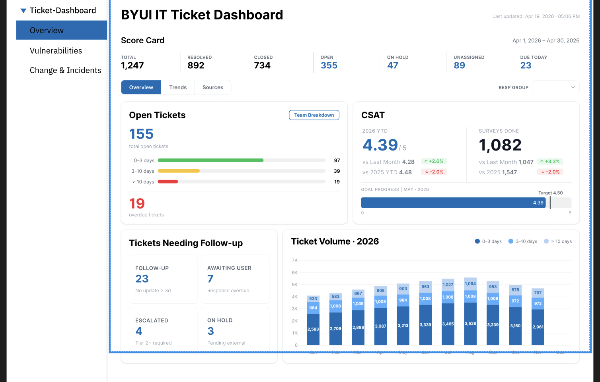

# BYUI IT Ticket Dashboard

[All materials](../README.md)

**Final goal:** Make ticket reporting easier to scan and use for department decisions.

**Main target users:** BYU-Idaho IT reporting users.

**Related teams and people:** Two student data analysts; Nepal, Richard and Lori; primary users and the IT CIO for design review.

## Context as of October 14, 2026

The BYU-Idaho IT dashboard serves the department's reporting users. Before the semester, surveys, meetings and a presentation to primary users and the IT CIO led to an approved design. The automation work and its test period also took place during the break.

This semester, two student data analysts have been implementing the design in Power BI with actual data. My role is UX/UI design and implementation review. The design organizes scorecards, open-ticket information, follow-up needs and trends into a clearer hierarchy.

The team reviewed a demo of one of the three main tabs last week. A separate temporary display keeps the earlier dashboard information in a tidier format; it is not the new design or the demo.

## Supporting materials

*Earlier dashboard, included as background to the design work.*

*Design reference being translated into Power BI. This is not a finished implementation screenshot.*

## Related record

[September 14 - October 14, 2026](../../records/2026-09-14_to_2026-10-14.md)
