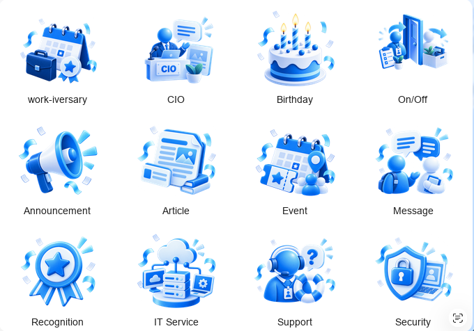
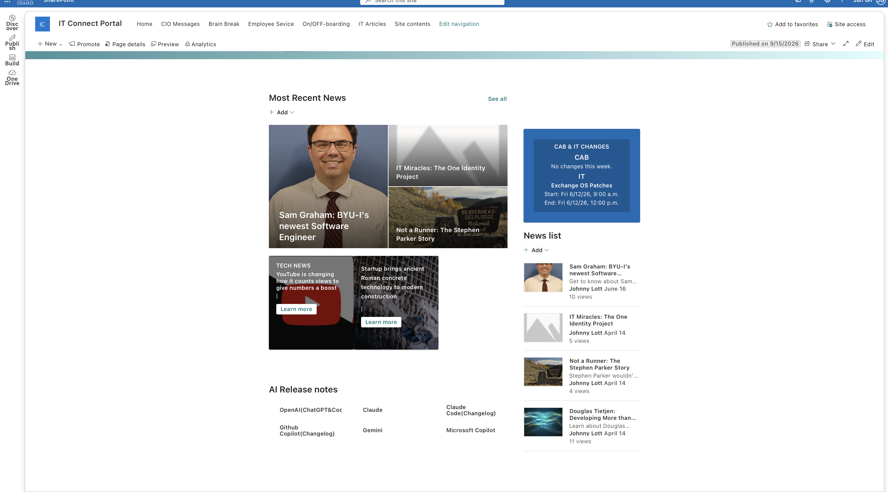
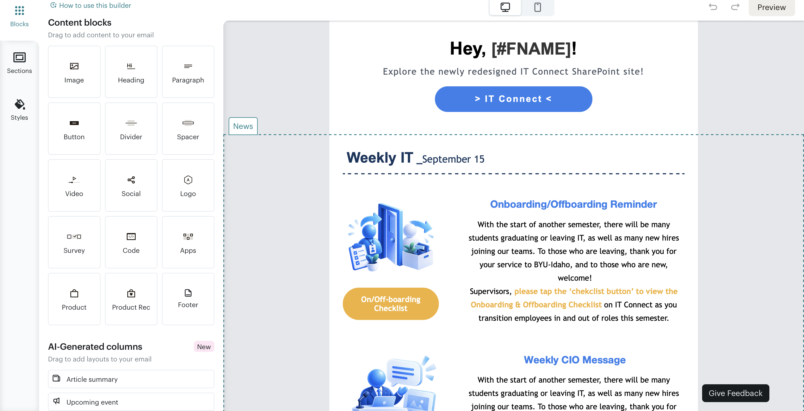
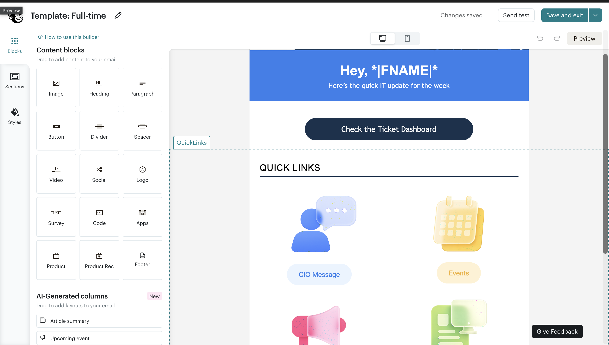
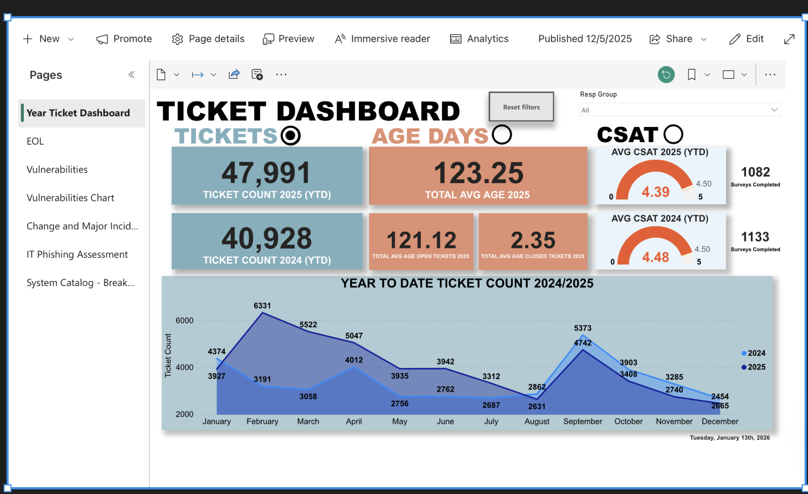
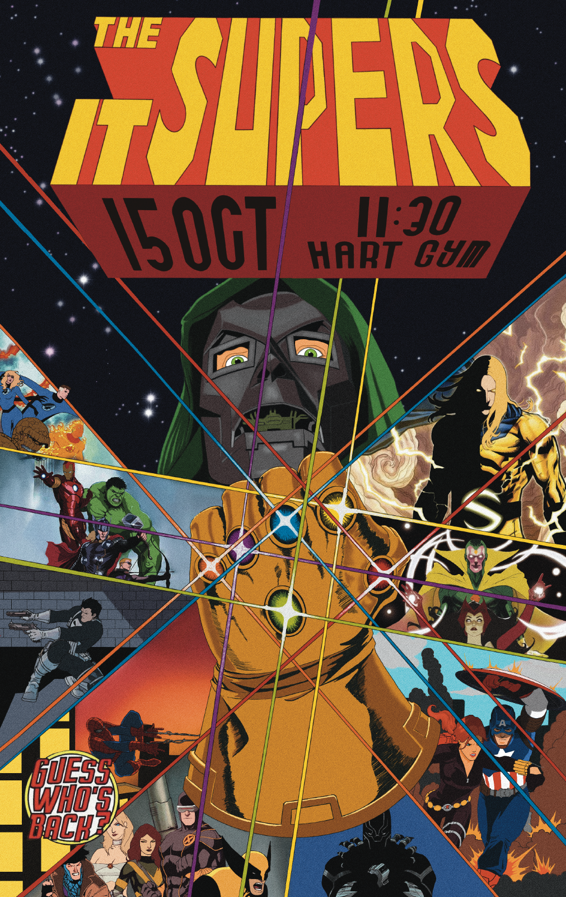
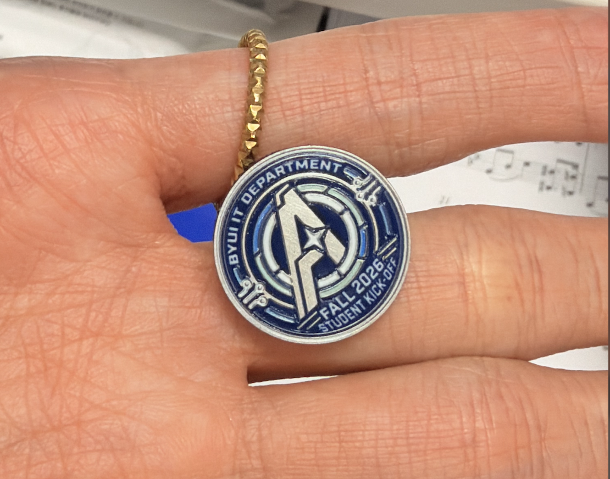

# September 14 - October 14, 2026

Published October 14, 2026

[All records](README.md) · [Project materials](../materials/README.md)

Since September 14, I have worked on department branding, IT Connect, newsletters, ticket dashboards and visual-team assignments.

Some projects began before the semester. Those sections include a brief background before the current work.

[Department Branding](#department-branding) · [IT Connect Website UX/UI](#it-connect-website-uxui) · [Department Newsletter UX/UI and Research](#department-newsletter-uxui-and-research) · [BYUI IT Ticket Dashboard](#byui-it-ticket-dashboard) · [CES CNC/SOC Dashboard](#ces-cncsoc-dashboard) · [Ticket Data Automation](#ticket-data-automation) · [Visual Team Leadership and Production](#visual-team-leadership-and-production)

## Department Branding

Project overview

**Final goal:** Build a recognizable visual identity across department communication.

**Main target users:** Student and full-time IT employees.

**Related teams and people:** Content-team manager and student visual team.

### Current progress

At the start of the internship, we had a new branding guide with colors and fonts, but no coordinated logo, mascot, icon or banner system. My manager developed the guide. I took the visual assets from ideas into design and production, with review from the content-team manager.

The website banners went through the largest change. I had initially focused on a general IT look. As we discussed department branding, I began working toward a shared identity across projects. I developed 3D icons for student communication and a flatter glass-style set for full-time staff. The logo and icons have been approved; the mascot remains an exploration.

Previously, events and other projects used different visual styles. Working across the website, newsletters and merchandise showed me why the department needs a consistent set of assets.

### Next steps

Next week, I plan to add the approved blue logo to the guide and begin using it in merchandise work.

*Student Icons (Approved)*

*Full-Time Icons (Approved)*

*Banners (Concept)*

[Department Branding](../materials/department-branding/README.md)

## IT Connect Website UX/UI

Project overview

**Final goal:** Bring department news, activities and employee services into one website.

**Main target users:** Student and full-time IT employees, with different paths for their needs.

**Related teams and people:** Content-team manager; ES manager Lori and ES student staff.

### Current progress

The weekly newsletter mainly shares department news. I am designing and building the SharePoint pages so employees can also find articles, join activities and access services between issues. I manage the pages myself.

Brain Break focuses on student participation through giveaways, events and surveys. IT Article combines department and outside articles with links to AI release notes. CIO Message separates recent messages and topic-based browsing so staff can find material by purpose.

The original Training and Learning page has developed into an Employee Services portal. It brings request forms, onboarding and LinkedIn learning resources together. The onboarding area links scheduling, slides, polo requests, team information and system resources. ES manager Lori and student staff reviewed the forms and suggested additions such as a building map.

The layout and structure are agreed, but the website is not yet in use. I still need to replace placeholder visuals, finish the content and make the links and forms ready for use.

### Next steps

I plan to finish the visuals, content, links and forms before the next ES review, scheduled for two weeks after our recent meeting.

*IT Article Layout (Draft)*

*Onboarding Layout (Draft)*

[IT Connect Website UX/UI](../materials/it-connect/README.md)

## Department Newsletter UX/UI and Research

Project overview

**Final goal:** Make each newsletter useful to its readers and connect them to IT Connect.

**Main target users:** Student employees and full-time employees, through separate editions.

**Related teams and people:** Content team and its manager.

### Current progress

I have developed separate newsletter structures for students and full-time employees. The student version uses 3D icons, varied layouts and activity links to encourage students to read and participate. The full-time version gives priority to direct links for information such as CIO messages, events and IT updates.

Both designs lead readers toward the website. Their structures are ready, but neither has launched because the destination pages still need to become usable. There are no survey results yet.

### Next steps

Once the website is usable, I plan to launch the new editions with a reader survey and use the feedback to guide changes.

*Student Newsletter (Draft)*

*Full-Time Newsletter (Draft)*

[Department Newsletter UX/UI and Research](../materials/newsletters/README.md)

## BYUI IT Ticket Dashboard

Project overview

**Final goal:** Make ticket reporting easier to scan and use for department decisions.

**Main target users:** BYU-Idaho IT reporting users.

**Related teams and people:** Two student data analysts; Nepal, Richard and Lori; primary users and the IT CIO for design review.

### Current progress

Before the semester, I developed the BYU-Idaho IT dashboard design through user surveys, meetings and a presentation to the primary users and IT CIO. They reviewed and approved the design. The automation work and its test period also took place during the break.

This semester, two student data analysts have been implementing the design in Power BI with actual data. My role is UX/UI design and implementation review. The design organizes scorecards, open-ticket information, follow-up needs and trends into a clearer hierarchy.

The team reviewed a demo of one of the three main tabs last week. A separate temporary display keeps the earlier dashboard information in a tidier format; it is not the new design or the demo.

### Next steps

A second-tab demo is planned for next week. I will continue reviewing the implementation against the approved design.

#### Dashboard Designs

| Earlier dashboard | Approved design |
| --- | --- |
|  |  |

I grouped the scorecards, open tickets, follow-up items and trends to give the report a clearer reading order.

[BYUI IT Ticket Dashboard](../materials/byui-ticket-dashboard/README.md)

## CES CNC/SOC Dashboard

Project overview

**Final goal:** Develop a new shared ticket-reporting dashboard for CES.

**Main target users:** CES CNC/SOC users across BYU, BYU-Idaho, BYU-Hawaii and Ensign College.

**Related teams and people:** Two student data analysts; Nepal, Richard and Lori; CES primary users for future UI discussions.

### Current progress

This is the first CES CNC/SOC dashboard, covering BYU, BYU-Idaho, BYU-Hawaii and Ensign College. It is separate from the BYUI dashboard.

The data team has organized the data and started the first Power BI implementation. My visual-design phase has not started.

### Next steps

After the initial implementation, discussions with the main users will guide information priorities and UI improvements. My visual-design phase will begin after that review.

[CES CNC/SOC Dashboard](../materials/ces-ticket-dashboard/README.md)

## Ticket Data Automation

Project overview

**Final goal:** Support dashboard reporting through a workflow the department can own and maintain.

**Main target users:** The dashboard and data-analysis team, supporting IT reporting users.

**Related teams and people:** Dashboard team and the department cloud contact for the planned Azure discussion.

### Current progress

I developed and tested the ticket-data automation before the semester. It supplies data for the dashboard work.

The next phase depends on completing the dashboard demos.

### Next steps

After the demos, we plan to review the demo and test documents with the department cloud contact. We will discuss moving the workflow to department-owned Azure and the budget needed to run it.

[Ticket Data Automation](../materials/ticket-data-automation/README.md)

## Visual Team Leadership and Production

Project overview

**Final goal:** Plan visual-team assignments and manage design review, printing and merchandise orders.

**Main target users:** IT student employees, department staff and event participants.

**Related teams and people:** Three-student visual team, including me; content-team manager; wider content, data and ES teams.

### Current progress

Our visual team has three student members, including me. At the start of the semester, my manager and I planned the content calendar, then divided recurring Instagram infographics, student kick-off visuals and birthday cards evenly. I handle the additional work outside those assignments.

For the kick-off materials, a teammate designed the poster, which my manager and I reviewed and approved for print and online distribution. I designed the pin, obtained the budget, placed the order and received the finished pieces.

Our Thursday student-team meeting and Friday review with the manager keep projects moving. The wider Thursday staff meeting connects our work with content, data analysis and ES. The two dashboard projects also have separate Monday meetings.

The approved department logo will also be used in the upcoming merchandise and onboarding materials.

### Next steps

Next week, I plan to start onboarding-slide and power-bank designs using the approved logo. Cybersecurity posts and screen advertisements are planned for late October.

*Kick-Off Poster (Final)*

*Kick-Off Pin (Final)*

[Visual Team Leadership and Production](../materials/visual-team-leadership/README.md)
