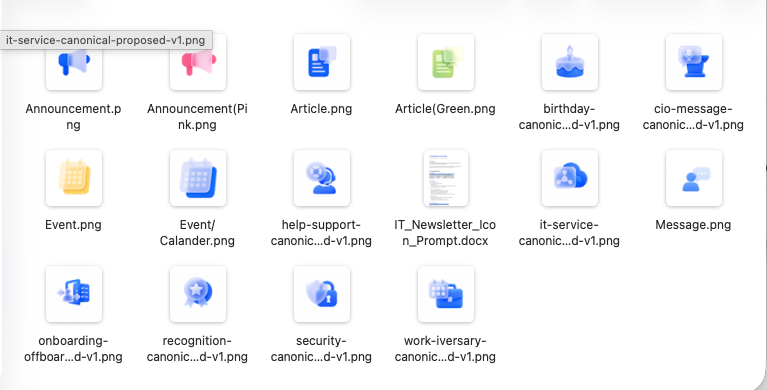
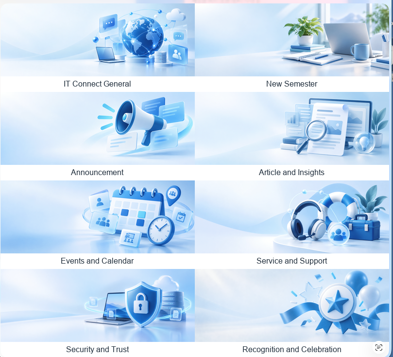
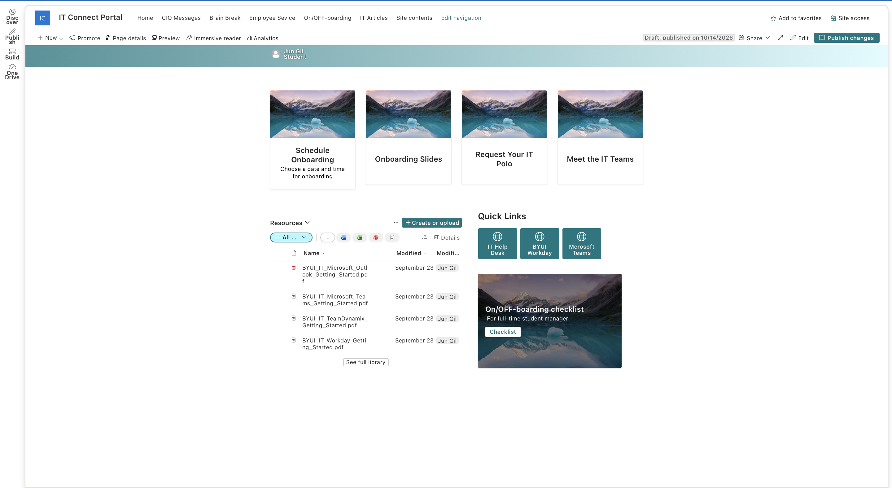

# September 14 - October 14, 2026

Published October 14, 2026 · Jun Gil

[All records](README.md) · [Project materials](../materials/README.md)

My first month of the semester has centered on making IT communication easier to recognize, navigate and use. As a designer and student visual-team lead at BYU-Idaho, I have been working across branding, SharePoint pages, newsletters and ticket dashboards.

This is a catch-up record for September 14 through October 14. Some projects began before the semester; I have included that background where it explains the work now underway.

## Department Branding

**Final goal:** Build a recognizable visual identity across department communication.

**Main target users:** Student and full-time IT employees.

**Related teams and people:** Content-team manager and student visual team.

### Current progress

At the start of the internship, we had a new branding guide with colors and fonts, but no coordinated logo, mascot, icon or banner system. My manager developed the guide. I took the visual assets from ideas into design and production, with review from the content-team manager.

The website banners went through the largest change. I had initially focused on a general IT look. As we discussed department branding, I began working toward a shared identity across projects. I developed 3D icons for student communication and a flatter glass-style set for full-time staff. The logo and icons have been approved; the mascot remains an exploration.

This changed how I think about recurring design work. An event graphic can work on its own, but the department also needs recognizable elements that carry into the next project.

### Next steps

Next week, I plan to add the approved blue logo to the guide and begin using it in merchandise work.

*Student icon set. The same recurring subjects carry across department communication.*

*Full-time icon direction, using simpler forms for the same content categories.*

*Banner exploration across announcements, articles, events, support and other recurring topics.*

[Supporting materials for this project](../materials/department-branding/README.md)

## IT Connect Website UX/UI

**Final goal:** Create a continuing hub for department information, participation and employee services.

**Main target users:** Student and full-time IT employees, with different paths for their needs.

**Related teams and people:** Content-team manager; ES manager Lori and ES student staff.

### Current progress

The weekly newsletter mainly shares department news. The IT Connect website is intended to give student and full-time employees a continuing place to find information, join activities and reach services. I design, build and manage the SharePoint pages myself.

Brain Break focuses on student participation through giveaways, events and surveys. IT Article combines department and outside articles with links to AI release notes. CIO Message separates recent messages and topic-based browsing so staff can find material by purpose.

The original Training and Learning page has developed into an Employee Services portal. It brings request paths, onboarding and LinkedIn learning resources together. The onboarding area links scheduling, slides, polo requests, team information and system resources. ES manager Lori and student staff reviewed the forms and suggested additions such as a building map.

The layout and structure are agreed, but the website is not yet in use. Placeholder visuals, content and working destinations still need attention.

### Next steps

I will finish the visual details, content and working destinations before the follow-up ES review, planned for two weeks after our recent meeting.

*IT Article layout in development. The page combines different routes to relevant reading.*

*Onboarding structure, before visual and content completion. The repeated images are placeholders.*

[Supporting materials for this project](../materials/it-connect/README.md)

## Department Newsletter UX/UI and Research

**Final goal:** Make each newsletter useful to its readers and connect them to IT Connect.

**Main target users:** Student employees and full-time employees, through separate editions.

**Related teams and people:** Content team and its manager.

### Current progress

I have developed separate newsletter structures for students and full-time employees. The student version uses more visual variety, 3D icons and activity links to make reading and participation more inviting. The full-time version gives priority to direct links for information such as CIO messages, events and IT updates.

Both designs lead readers toward the website. Their structures are ready, but neither has launched because the destination pages still need to become usable. There are no survey results yet.

### Next steps

Once the website is usable, I plan to launch the new editions with a reader survey and use the feedback to guide changes.

*Student newsletter draft in the editor, with sample copy and illustrated sections.*

*Full-time newsletter draft, emphasizing direct access to selected categories.*

[Supporting materials for this project](../materials/newsletters/README.md)

## BYUI IT Ticket Dashboard

**Final goal:** Make ticket reporting easier to scan and use for department decisions.

**Main target users:** BYU-Idaho IT reporting users.

**Related teams and people:** Two student data analysts; Nepal, Richard and Lori; primary users and the IT CIO for design review.

### Current progress

The BYU-Idaho IT dashboard serves the department's reporting users. Before the semester, surveys, meetings and a presentation to primary users and the IT CIO led to an approved design. The automation work and its test period also took place during the break.

This semester, two student data analysts have been implementing the design in Power BI with actual data. My role is UX/UI design and implementation review. The design organizes scorecards, open-ticket information, follow-up needs and trends into a clearer hierarchy.

The team reviewed a demo of one of the three main tabs last week. A separate temporary display keeps the earlier dashboard information in a tidier format; it is not the new design or the demo.

### Next steps

A second-tab demo is planned for next week. I will continue reviewing the implementation against the approved design.

*Earlier dashboard, included as background to the design work.*

*Design reference being translated into Power BI. This is not a finished implementation screenshot.*

[Supporting materials for this project](../materials/byui-ticket-dashboard/README.md)

## CES CNC/SOC Dashboard

**Final goal:** Develop a new shared ticket-reporting dashboard for CES.

**Main target users:** CES CNC/SOC users across BYU, BYU-Idaho, BYU-Hawaii and Ensign College.

**Related teams and people:** Two student data analysts; Nepal, Richard and Lori; CES primary users for future UI discussions.

### Current progress

The CES CNC/SOC dashboard is a new project for a different audience, covering work across BYU, BYU-Idaho, BYU-Hawaii and Ensign College. There is no previous CES dashboard being redesigned.

The data team has organized the data and started the first Power BI implementation. My visual-design phase has not started.

### Next steps

After the initial implementation, discussions with the main users will guide information priorities and UI improvements. My visual-design phase will begin after that review.

[Supporting materials for this project](../materials/ces-ticket-dashboard/README.md)

## Ticket Data Automation

**Final goal:** Support dashboard reporting through a workflow the department can own and maintain.

**Main target users:** The dashboard and data-analysis team, supporting IT reporting users.

**Related teams and people:** Dashboard team and the department cloud contact for the planned Azure discussion.

### Current progress

The ticket-data automation supports the dashboard work. Its development and testing were completed before this semester, so I treat them as project background rather than new internship output.

The project is waiting for the dashboard demos before the planned Azure ownership and budget discussion.

### Next steps

After the dashboard demos, the team plans to bring the demonstration and test documentation to the department cloud contact to discuss department-owned Azure and budget. That meeting has not happened yet.

[Supporting materials for this project](../materials/ticket-data-automation/README.md)

## Visual Team Leadership and Production

**Final goal:** Coordinate recurring communication and carry approved designs into production.

**Main target users:** IT student employees, department staff and event participants.

**Related teams and people:** Three-student visual team, including me; content-team manager; wider content, data and ES teams.

### Current progress

Our visual team has three student members, including me. At the start of the semester, my manager and I planned the content calendar, then divided recurring Instagram infographics, student kick-off visuals and birthday cards evenly. I handle the additional work outside those assignments.

For the kick-off materials, a teammate designed the poster, which my manager and I reviewed and approved for print and online distribution. I designed the pin, obtained the budget, placed the order and received the finished pieces. That involved following the design through proofing and production, not just completing a screen mockup.

Our Thursday student-team meeting and Friday review with the manager keep projects moving. The wider Thursday staff meeting connects our work with content, data analysis and ES. The two dashboard projects also have separate Monday meetings.

Across these assignments, I am connecting one design decision to the next instead of treating every output as a separate visual identity.

### Next steps

Next week, I plan to start onboarding-slide and power-bank designs using the approved logo. Cybersecurity posts and screen advertisements are planned for late October.

*Event poster designed by a teammate. My role was review and approval with the manager.*

*The finished pin I designed and took through budgeting, ordering and production.*

[Supporting materials for this project](../materials/visual-team-leadership/README.md)
