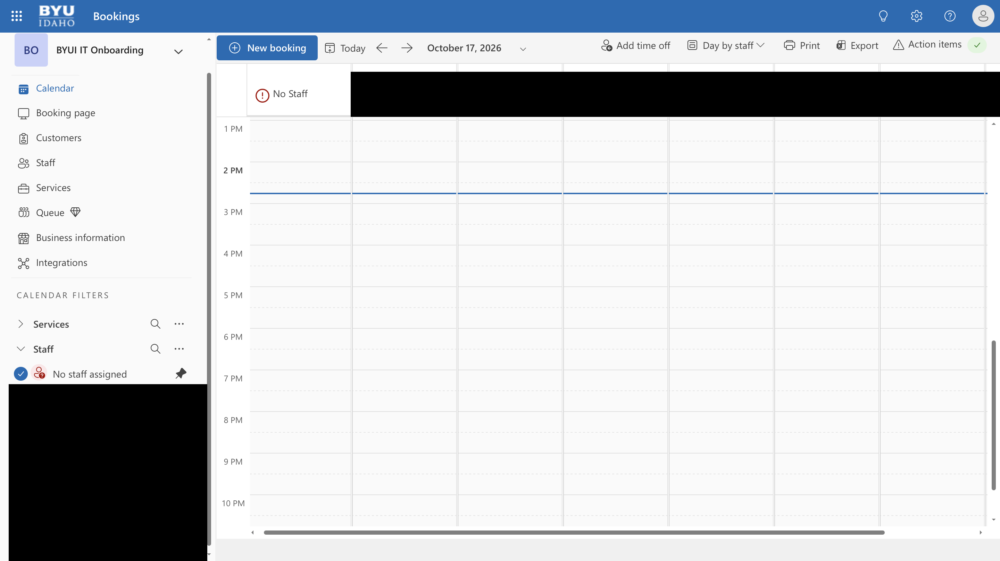

# October 16, 2026

[All records](README.md) · [Project materials](../materials/README.md)

[Department Branding](#department-branding) · [IT Connect Website UX/UI](#it-connect-website-uxui) · [CES CNC/SOC Dashboard](#ces-cncsoc-dashboard)

## Department Branding

Project overview

**Final goal:** Build a recognizable visual identity across department communication.

**Main target users:** Student and full-time IT employees.

**Related teams and people:** Content-team manager and student visual team.

### Current progress

The weekly design-team meeting was canceled, but I still discussed the icons and banners with teammates and my manager. The response was positive, and we agreed to continue with the current direction.

### Next steps

Continue developing the icons and banners in the agreed direction.

[Department Branding](../materials/department-branding/README.md)

## IT Connect Website UX/UI

Project overview

**Final goal:** Bring department news, activities and employee services into one website.

**Main target users:** Student and full-time IT employees, with different paths for their needs.

**Related teams and people:** Content-team manager; ES manager Lori and ES student staff.

### Current progress

Previously, onboarding staff arranged a time with each student through individual email exchanges. I wanted to replace that back-and-forth with a booking page.

I configured and finalized the ES onboarding scheduling flow using Microsoft Bookings. I demonstrated it to the responsible manager, received approval, explained the management settings, and then taught the onboarding staff how to set it up.

The page uses the existing Bookings interface, so most of my work was in the service settings. I added a team-name question and configured notifications and Outlook calendar entries for both the person booking and the assigned staff member. I wanted to cover the details this onboarding service needs beyond the default setup.

As a UX/UI student, I found the idea of changing that scheduling process valuable in itself. Bookings provided most of the interface, but recognizing an inefficient routine and proposing a booking system was still a design decision.

The scheduling flow is approved; the rest of the website remains in development.

*Onboarding Booking Calendar (Approved)*

[Onboarding Booking (Approved)](https://bookings.cloud.microsoft/book/BYUIITOnboarding@webmailbyui.onmicrosoft.com/?ismsaljsauthenabled)

### Next steps

Continue the remaining ES page development.

[IT Connect Website UX/UI](../materials/it-connect/README.md)

## CES CNC/SOC Dashboard

Project overview

**Final goal:** Develop a new shared ticket-reporting dashboard for CES.

**Main target users:** CES CNC/SOC users across BYU, BYU-Idaho, BYU-Hawaii and Ensign College.

**Related teams and people:** Two student data analysts; Nepal, Richard and Lori; CES primary users for future UI discussions.

### Current progress

I did some background research because I am still unfamiliar with the CES ticket-dashboard context. I looked for dashboards used by other organizations and the kinds of information they typically display. I also used AI conversations to help me study the topic.

This was preparation for future design work. I have not started the CES dashboard UI yet.

### Next steps

Continue learning about ticket-dashboard information before the planned user discussions and UI work.

[CES CNC/SOC Dashboard](../materials/ces-ticket-dashboard/README.md)
