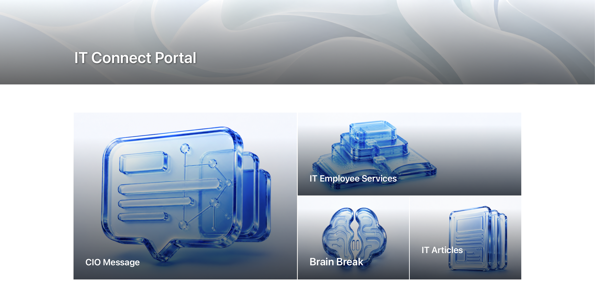
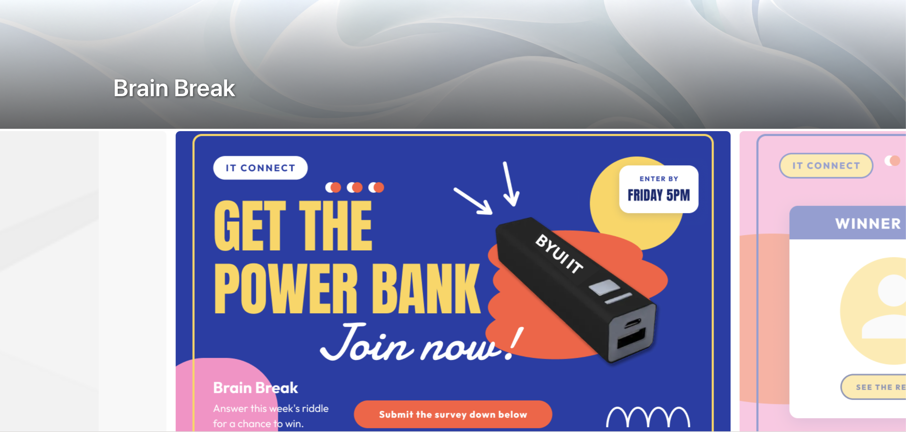

# October 19, 2026

[All records](README.md) · [Project materials](../materials/README.md)

[IT Connect Website UX/UI](#it-connect-website-uxui)

## IT Connect Website UX/UI

Project overview

**Final goal:** Bring department news, activities and employee services into one website.

**Main target users:** Student and full-time IT employees, with different paths for their needs.

**Related teams and people:** Content-team manager; ES manager Lori and ES student staff.

### Current progress

I refined the banners for IT Connect and applied a shared treatment across the pages. Following the department's existing branding direction, I used a pale blue-gray abstract background and consistent title placement. The pages cover different kinds of content, so I wanted their headers to look like parts of the same website.

*IT Connect Home (Draft)*

*Brain Break Page (Draft)*

### Next steps

Develop the icons and card graphics that will accompany the page banners.

[IT Connect Website UX/UI](../materials/it-connect/README.md)
