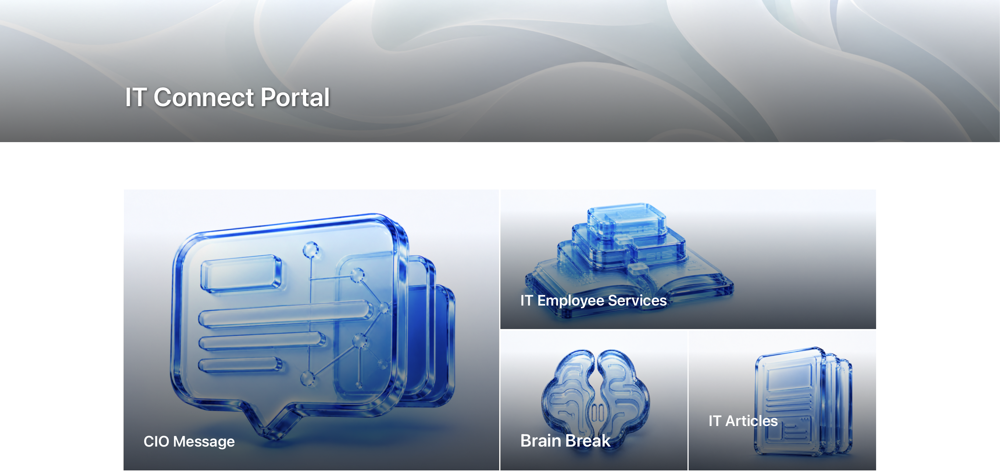
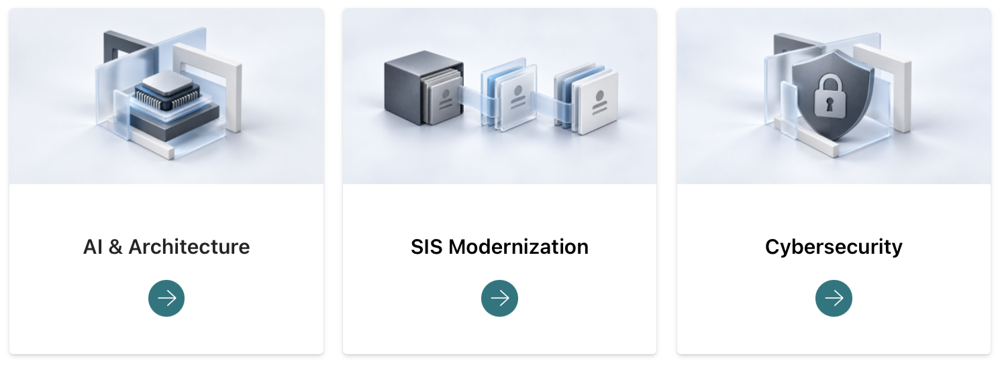

# October 20, 2026

[All records](README.md) · [Project materials](../materials/README.md)

[IT Connect Website UX/UI](#it-connect-website-uxui)

## IT Connect Website UX/UI

Project overview

**Final goal:** Bring department news, activities and employee services into one website.

**Main target users:** Student and full-time IT employees, with different paths for their needs.

**Related teams and people:** Content-team manager; ES manager Lori and ES student staff.

### Current progress

I adapted the existing icon style for different pages and topics. On the home page, I used separate graphics for CIO Message, Employee Services, Brain Break and IT Articles.

For the CIO topic cards, I replaced the repeated landscape photos with images representing AI and architecture, system modernization, and cybersecurity. I matched the graphics to the topics so the images could help identify each category before someone reads its label.

*IT Connect Home (Draft)*

*CIO Topic Cards (Draft)*

### Next steps

Apply the same approach to the service and training cards on the Employee Services page.

[IT Connect Website UX/UI](../materials/it-connect/README.md)
