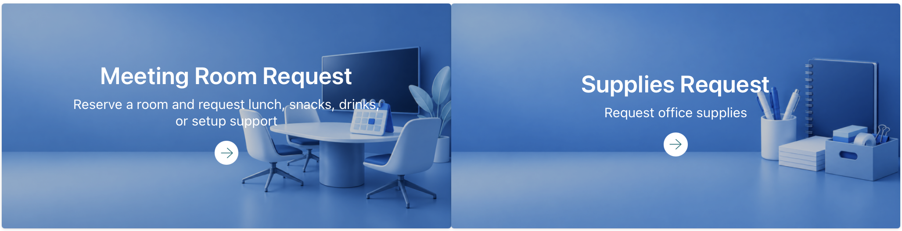
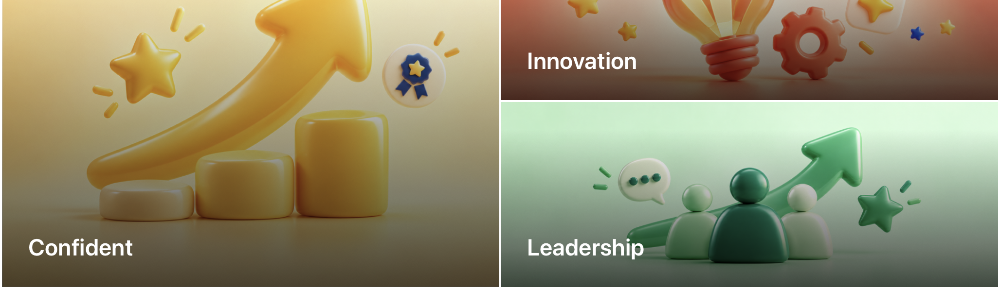

# October 21, 2026

[All records](README.md) · [Project materials](../materials/README.md)

[IT Connect Website UX/UI](#it-connect-website-uxui)

## IT Connect Website UX/UI

Project overview

**Final goal:** Bring department news, activities and employee services into one website.

**Main target users:** Student and full-time IT employees, with different paths for their needs.

**Related teams and people:** Content-team manager; ES manager Lori and ES student staff.

### Current progress

I replaced placeholder images on Employee Services with illustrations for each service. I created and applied meeting-room, office-supply and onboarding graphics to match the tasks behind the cards.

I used blue tones for the request services and different colors for the training cards. I kept the existing request, onboarding and training structure while making the purpose of each card more specific through its imagery.

*Employee Service Cards (Draft)*

*Training Cards (Draft)*

### Next steps

Refine the cards and resource sections on the connected onboarding page.

[IT Connect Website UX/UI](../materials/it-connect/README.md)
