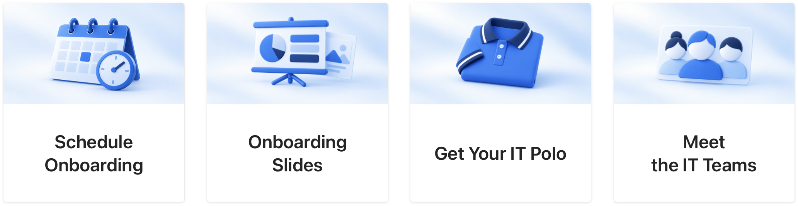
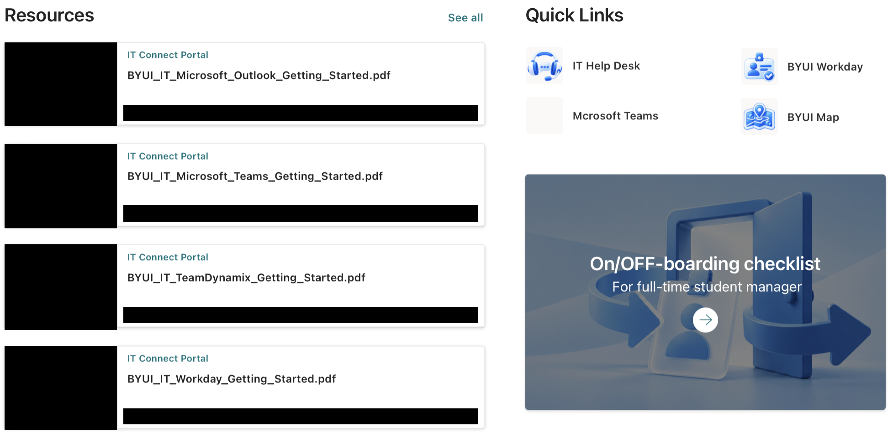

# October 22, 2026

[All records](README.md) · [Project materials](../materials/README.md)

[IT Connect Website UX/UI](#it-connect-website-uxui)

## IT Connect Website UX/UI

Project overview

**Final goal:** Bring department news, activities and employee services into one website.

**Main target users:** Student and full-time IT employees, with different paths for their needs.

**Related teams and people:** Content-team manager; ES manager Lori and ES student staff.

### Current progress

I updated the four onboarding cards that had used the same landscape photo. Scheduling, slides, polo requests and team information now have calendar, presentation, polo and people graphics.

I also changed the resources area from a library table to document preview cards and added icons to the quick links. I kept the existing onboarding tasks and worked on how the page presents them to a new employee.

*Onboarding Task Cards (Draft)*

*Onboarding Resources (Draft)*

### Next steps

Apply the visual treatment to the remaining pages and review the site as a whole.

[IT Connect Website UX/UI](../materials/it-connect/README.md)
