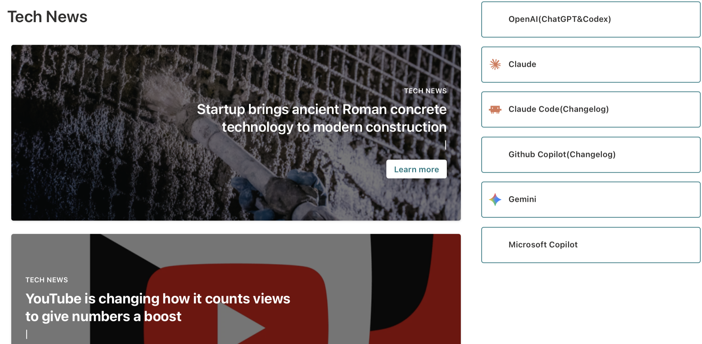
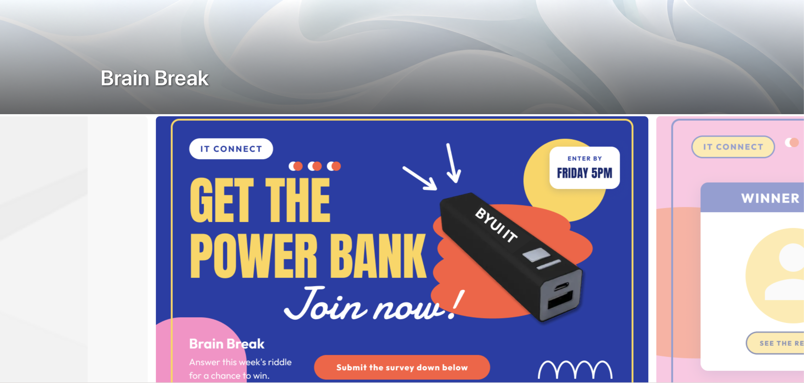

# October 23, 2026

[All records](README.md) · [Project materials](../materials/README.md)

[IT Connect Website UX/UI](#it-connect-website-uxui)

## IT Connect Website UX/UI

Project overview

**Final goal:** Bring department news, activities and employee services into one website.

**Main target users:** Student and full-time IT employees, with different paths for their needs.

**Related teams and people:** Content-team manager; ES manager Lori and ES student staff.

### Current progress

I refined the IT Articles page to separate department news, outside tech news and AI update links. I arranged department news as a lead story with a smaller story list, then placed the article-suggestion card and AI update links in the right column.

On Brain Break, I retained the event carousel and applied the shared banner. Across the site, I kept the content presentation suited to each page while bringing the banners, icons and cards into a consistent visual direction.

*Tech News and AI Links (Draft)*

*Brain Break Page (Draft)*

### Next steps

Finish the remaining placeholder text and content, and check the linked pages and services. Connect the redesigned newsletters once the website is ready to use.

[IT Connect Website UX/UI](../materials/it-connect/README.md)
